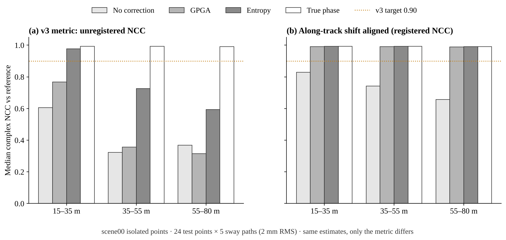
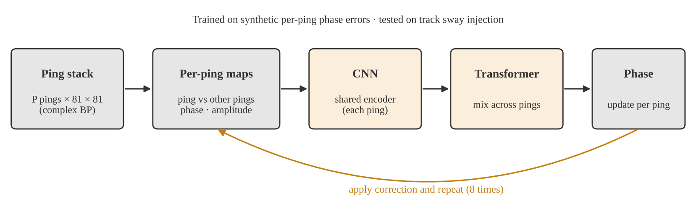
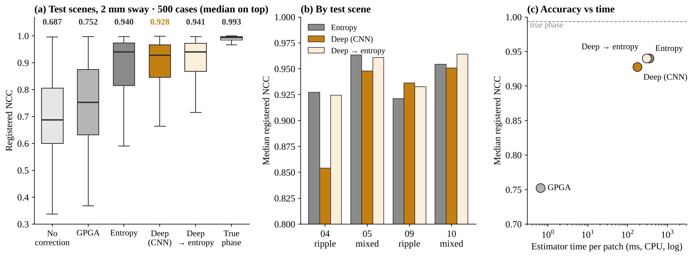
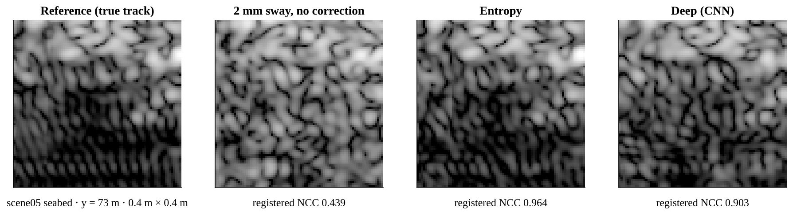
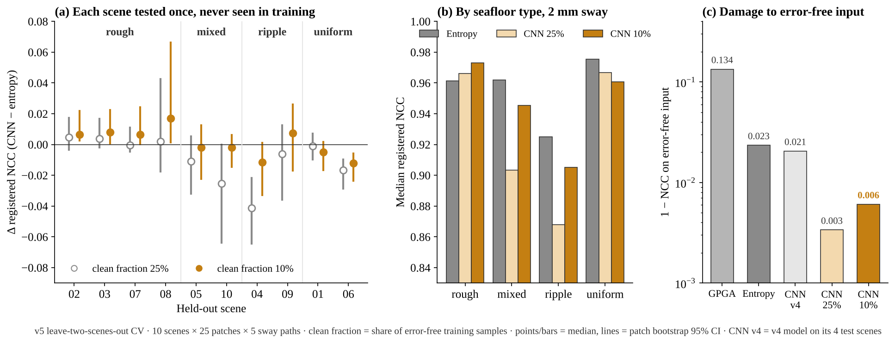

# Synthetic Aperture Sonar Imaging and Navigation-Error Sensitivity

공개 합성개구 소나(Synthetic Aperture Sonar, SAS) 시뮬레이션 자료의 원시 신호(raw IQ)로 영상 형성과 항법 오차 보정을 직접 구현하고, 기준 영상과 비교해 항법 오차의 영향과 딥러닝 보정(deep autofocus)의 효과를 측정한 벤치마크

<p align="center"></p>

## Background

- SAS는 이동하며 수신한 여러 핑을 합성해 고해상도 영상을 만드는 방식으로, SAR에서 발전함 (Hayes & Gough, 2009)
- 영상 형성의 전제
  - 송수신 중 플랫폼이 멈춰 있다는 정지 가정(stop-and-hop)은 저속 · 짧은 펄스에서만 성립함 (Hawkins & Gough, 2004)
  - 핑 간 좌우 위치를 수십 μm 수준으로 알아야 함 → 미세항법(micronavigation)이 필요함 (Bellettini & Pinto, 2002)
- 항법 오차 보정(autofocus)
  - 위상 기울기 보정(PGA)이 SAR 위상 보정의 표준으로 쓰임 (Wahl 등, 1994)
  - 스트립맵 SAS용 PGA가 제안됨. 현장 자료에서는 공간 가변 흐림으로 보정이 어려움 (Callow)
  - 영상 엔트로피 최소화로 위상 오차를 추정하는 방법이 쓰임 (Xi, Liu & Ni, 1999)
  - 흐린 영상에서 위상 오차를 바로 추정하는 딥러닝 보정이 제안됨. 위상 오차를 합성한 영상으로 학습함 (Gerg & Monga, 2020; 2021)
- 공개 SAS 자료는 대부분 처리된 영상만 제공함 → PoSSM은 원시 신호 · 기준 영상 · 산란체 위치를 함께 제공함 (Philtron, Johnson & Brown)

## Benchmark Setup

| 항목 | 내용 |
|---|---|
| 자료 | PoSSM (MGDS) · 11장면 (60 m × 90 m) · 원시 GDF + 기준 영상(ASASIN SLC) · 무잡음 시뮬레이션 |
| 영상 형성 | 정합필터 → 송수신 분리(bistatic) 역투영, 정지 가정 vs 수신기 이동 반영 |
| 항법 오차 | 처리용 항적에 진행(surge) · 좌우(sway) 오차와 음속 편향을 넣어 민감도 측정 |
| 보정 | local GPGA · 핑별 엔트로피 최소화 · 딥러닝 보정(CNN + transformer) |
| 딥러닝 보정 자료 | 해저면 0.4 m 조각 · v4: 학습 4장면 → 검증 2장면 → 시험 4장면 (v2 장면 분할) · v5: 10장면을 2장면씩 돌려가며 시험하는 장면 교차검증 (250조각 × 5경로) |
| 지표 | 산란체 위치 오차(mm) · 기준 영상과의 복소 상관(complex NCC) · 진행 방향 평행이동을 맞춘 NCC(registered NCC) |
| 평가 규칙 | 개발 · 검증 자료로 조건을 정한 뒤 시험 자료로 1회 평가 ([`results/v3/protocol.json`](results/v3/protocol.json), [`results/v4/protocol.json`](results/v4/protocol.json), [`results/v5/protocol.json`](results/v5/protocol.json)) |

## Results

| 비교 | 결과 |
|---|---|
| 정지 가정 vs 수신기 이동 반영 | 산란체 위치 오차 15.1 → 1.8 mm |
| 처리 설정 (Hann + Gaussian 창) | 기준 영상 NCC 0.672 → 0.875 |
| 항법 오차 민감도 (2 mm RMS) | 좌우 NCC 0.50 · 진행 방향 0.99 |
| 항법 오차 보정, 고립점 (평행이동 정렬 NCC) | 보정 없음 0.741 → GPGA 0.991 · 엔트로피 0.993 (정답 위상 0.993) |
| 딥러닝 보정, 해저면 10장면 교차검증 1,250건 | CNN 0.959 · 엔트로피 0.960 (차이 +0.001, 95% CI −0.001–0.004) · 처리 시간 약 1/2 · 오차 없는 입력 손실 약 1/4 |

### 영상 형성

<p align="center"></p>
<p align="center"><sub>정지 가정(stop-and-hop)과 수신기 이동 반영 모델의 위치 오차 (산란체 24개)</sub></p>

- 처리 설정 후 NCC 상승(0.672 → 0.875)은 기준 영상과 창 처리가 비슷해진 결과이며, 영상 품질 향상을 뜻하지는 않음 (진행 방향 3 dB 주엽 폭 24.4 → 26.8 mm)

<details>
<summary>처리 설정 (보간 · 창 · PSF)</summary>

<p align="center"></p>
<p align="center"><sub>개발용 3점에서 보간 배율과 창 설정 비교</sub></p>

<p align="center"></p>
<p align="center"><sub>시험 24점의 복소수 상관과 진폭 상관</sub></p>

<p align="center"></p>
<p align="center"><sub>창 적용 전후 PSF (진행 방향 · 거리 방향)</sub></p>

</details>

### 항법 오차 민감도

<p align="center"></p>
<p align="center"><sub>항적 오차(진행 · 좌우 · 동시)와 음속 편향에 따른 영상 일치도 (24점 × 5경로)</sub></p>

- 좌우 방향 오차가 진행 방향 오차보다 영상에 훨씬 민감함 (2 mm RMS에서 NCC 0.50 vs 0.99)

### 항법 오차 보정

<p align="center"></p>
<p align="center"><sub>고립점 시험(24점 × 5경로)의 거리 구간별 결과. 같은 보정 결과에 지표만 다르게 적용</sub></p>

| 거리 | 15–35 m | 35–55 m | 55–80 m |
|---|---|---|---|
| 엔트로피, 기존 NCC | 0.977 | 0.726 | 0.594 |
| 엔트로피, 평행이동 정렬 NCC | 0.994 | 0.993 | 0.991 |

- 핑 간 선형 위상은 영상을 진행 방향으로 평행이동시킴. 기준 없이 보정하는 방법으로는 복원할 수 없는 성분임
- 기존 NCC는 이 평행이동까지 오차로 셈 → v3에서 보고한 먼 거리 효과 감소는 보정 실패가 아니라 지표에 섞인 평행이동임
- 평행이동을 맞추면 GPGA · 엔트로피 모두 정답 위상 수준에 도달함 (거리 무관)

### 딥러닝 보정 (deep autofocus)

<p align="center"></p>
<p align="center"><sub>모델 구조 (41만 파라미터). 핑마다 나머지 핑과의 위상 · 진폭 관계를 CNN으로 요약하고, transformer로 핑 간 정보를 섞어 위상을 갱신</sub></p>

- 강한 점이 없는 해저면에서는 GPGA가 약함 → 딥러닝 보정의 비교 대상으로 해저면 조각을 사용
- 학습: 학습 장면(거친 해저면)의 오차 없는 조각에 핑별 위상 오차를 합성 (Gerg & Monga 방식)
- 시험: 학습에 없던 물결 · 혼합 해저면 4장면, 처리용 항적에 2 mm 좌우 오차를 넣어 생성 (v3와 같은 방식)

<p align="center"></p>
<p align="center"><sub>시험 4장면 100조각 × 5경로 결과</sub></p>

| 방법 | NCC 중앙값 | 하위 10% | 오차 없는 입력 손실 (중앙값) | 처리 시간 |
|---|---|---|---|---|
| 보정 없음 | 0.687 | – | 0 | – |
| GPGA | 0.752 | 0.563 | 0.144 | 0.6 ms |
| 엔트로피 | 0.940 | 0.706 | 0.038 | 345 ms |
| **CNN** | **0.928** | **0.721** | **0.021** | **173 ms** |
| CNN → 엔트로피 | 0.941 | 0.720 | 0.038 | 296 ms |
| 정답 위상 | 0.993 | – | 0 | – |

- CNN과 엔트로피의 차이는 통계적으로 구분되지 않음 (−0.006, 95% CI −0.014–0.002). 처리 시간은 약 절반
- 물결 해저면 scene04에서 CNN이 약함 (0.854 vs 엔트로피 0.927) → 아래 장면 교차검증(v5)으로 원인 확인
- 모든 방법이 정답 위상(0.993)과 0.05 이상 차이 → 해저면 조각 보정에 개선 여지가 남음
- 처리 시간은 CPU 2코어 기준. 학습 3,000단계 약 1시간 ([`results/v4/environment.json`](results/v4/environment.json))

<p align="center"></p>
<p align="center"><sub>시험 조각 예시 (scene05, 엔트로피 결과가 중앙값에 가까운 조각)</sub></p>

#### 장면 교차검증 (v5)

- v4 학습은 4회, 추론은 8회 반복 → 5–8회째 단계 정보가 학습되지 않은 채 쓰임 → 학습 · 추론 모두 8회로 맞춤
- 10장면을 2장면씩 5묶음으로 나눔. 묶음마다 나머지 8장면으로 학습하고 해당 2장면으로 시험 → 모든 장면이 학습에 없던 상태로 1회씩 시험됨
- 묶음마다 물결 · 혼합 장면이 학습에 들어가도록 나눔
- 학습 자료 중 오차 없는 조각 비율 2가지 비교: 25% (사전 고정 조건) · 10% (v4와 같음, 25% 결과를 본 뒤 추가)

<p align="center"></p>
<p align="center"><sub>장면 교차검증 결과 (10장면 × 25조각 × 5경로). (a) 장면별 CNN − 엔트로피 차이와 95% CI, (b) 해저 유형별 NCC, (c) 오차 없는 입력 손실</sub></p>

| 해저 유형 | 시험 장면 | 엔트로피 | CNN (25%) | CNN (10%) | 차이, 10% (95% CI) |
|---|---|---|---|---|---|
| 거친 (rough) | 02 · 03 · 07 · 08 | 0.961 | 0.966 | **0.973** | +0.008 (0.004–0.015) |
| 혼합 (mixed) | 05 · 10 | 0.962 | 0.903 | **0.945** | −0.002 (−0.011–0.004) |
| 물결 (ripple) | 04 · 09 | 0.925 | 0.868 | **0.905** | −0.003 (−0.019–0.009) |
| 균일 (uniform) | 01 · 06 | 0.975 | 0.967 | **0.961** | −0.010 (−0.017 – −0.003) |
| 전체 | 10장면 | 0.960 | 0.950 | **0.959** | +0.001 (−0.001–0.004) |
| 오차 없는 입력 손실 | | 0.023 | 0.003 | 0.006 | |

- 반복 횟수를 맞추고 다른 해저 유형을 학습에 넣으면 scene04 차이가 줄어듦 (v4 −0.032 → −0.012, 95% CI −0.033–0.001). 같은 물결 해저면인 scene09는 +0.007 → 물결 해저면 전체의 열세는 아님
- 거친 해저면은 CNN이 엔트로피보다 조금 높고, 균일 해저면은 조금 낮음. 혼합 · 물결은 구분되지 않음
- 오차 없는 조각 25%: 오차 없는 입력 손실은 가장 작지만(0.003) 보정이 약해짐 (전체 차이 −0.004, 95% CI −0.008 – −0.001) → 보존과 보정 사이의 교환관계(trade-off). 10%에서는 정확도는 엔트로피와 같고 손실은 엔트로피보다 작음
- 조각 특징(speckle 대비, 핑 간 결맞음, 핑 수, 거리)과 차이의 상관은 약함 (|ρ| ≤ 0.13)
- CNN → 엔트로피는 엔트로피 단독과 같은 해로 수렴 (차이 0.000)
- 10% 조건은 25% 시험 결과를 본 뒤 추가한 사후 비교임 ([`results/v5_ablation/`](results/v5_ablation/))

- 결과 수치: [`results/v2/`](results/v2/), [`results/v3/`](results/v3/), [`results/v4/`](results/v4/), [`results/v5/`](results/v5/) · 사전 고정 조건: [`results/v3/protocol.json`](results/v3/protocol.json), [`results/v4/protocol.json`](results/v4/protocol.json), [`results/v5/protocol.json`](results/v5/protocol.json) · 보고서: [`report_v3/report.html`](report_v3/report.html)

<details>
<summary>부록: 객체 탐지 시도 (사전 기준 미달)</summary>

- 후보 생성 + Random Forest로 시험 4장면 물체 36개 중 9개 탐지 (재현율 0.25, 장면당 오경보 2.75, 사전 기준 0.8 미달)

<p align="center"></p>
<p align="center"><sub>시험 4장면 점 단위 FROC와 고정 운영점</sub></p>

<p align="center"></p>
<p align="center"><sub>시험 장면 04의 탐지 예시와 클래스 결과</sub></p>

</details>

## Takeaways

- 수신기 이동 반영\
  → 정지 가정 대비 위치 오차 약 1/8 (15.1 → 1.8 mm). mm급 영상 형성의 전제 조건
- 항법 오차의 영향\
  → 좌우 방향 mm 단위 오차가 영상 품질을 좌우함. 미세항법 정확도 요구(Bellettini & Pinto, 2002)를 수치로 확인
- 보정 평가 지표\
  → 기준 없는 보정은 진행 방향 평행이동을 복원할 수 없음. 평행이동을 맞춰 비교하면 고립점 보정은 거리와 무관하게 정답 위상 수준
- 딥러닝 보정\
  → 학습에 없던 10장면 교차검증에서 엔트로피와 같은 정확도(0.959 vs 0.960)를 약 절반의 처리 시간으로 냄. 오차 없는 입력 손실은 약 1/4
- 학습 · 추론 조건 일치\
  → 반복 횟수 불일치를 고치자 v4 scene04 열세가 크게 줄어듦. 오차 없는 조각 비율이 보존과 보정 사이의 균형을 정함

## Limitations → Next Steps

- 균일 해저면에서 CNN이 엔트로피보다 조금 낮음 (차이 −0.010)\
  → 해저 유형별 장면 수 확대 (현재 유형당 2–4장면)
- 오차 없는 조각 비율 10%는 시험 결과를 본 뒤 추가한 조건\
  → 새 장면이나 잡음을 넣은 시뮬레이션에서 사전 고정 조건으로 재확인
- 모든 방법이 정답 위상과 0.05 이상 차이\
  → 큰 조각 · 장면 전체 보정, 공간 가변 오차 추정으로 확장
- 처리 시간이 CPU 2코어 기준\
  → GPU 일괄 추론으로 실시간성 평가 (Gerg & Monga, 2021)
- 무잡음 시뮬레이션 한 종류\
  → 잡음을 넣은 시뮬레이션으로 재평가 후 실측 SAS로 확장. 시뮬레이션 자료의 충실도 문제(Blanford & Williams, 2024) 고려
- 항법 오차를 원시 신호가 아닌 처리용 항적에 넣어 생성\
  → 원시 신호 단계에서 항법 오차를 넣은 시뮬레이션으로 검증
- 기준 영상과의 장면 전체 차이 원인 미분리\
  → 거리별 진폭 규약 · 보간 · 창 처리를 단계별로 분리 비교
- 부록 탐지 시험 표본이 작음 (4장면, 물체 36개)\
  → 장면 · 물체 수를 늘려 재평가

## References

- Bellettini, A., & Pinto, M. A. (2002). Theoretical accuracy of synthetic aperture sonar micronavigation using a displaced phase-center antenna. *IEEE Journal of Oceanic Engineering*, 27(4), 780–789.
- Blanford, T. E., & Williams, D. P. (2024). Understanding model fidelity for training synthetic aperture sonar image classifiers. *Proc. ICUA 2024*, Institute of Acoustics, 46(1).
- Callow, H. J. Signal processing for synthetic aperture sonar image enhancement. PhD thesis, University of Canterbury. [ir.canterbury.ac.nz/handle/10092/7140](https://ir.canterbury.ac.nz/handle/10092/7140)
- Gerg, I. D., & Monga, V. (2020). Deep autofocus for synthetic aperture sonar. [arXiv:2010.15687](https://arxiv.org/abs/2010.15687)
- Gerg, I. D., & Monga, V. (2021). Real-time, deep synthetic aperture sonar (SAS) autofocus. [arXiv:2103.10312](https://arxiv.org/abs/2103.10312)
- Hawkins, D. W., & Gough, P. T. (2004). Temporal Doppler effects in SAS. *Proceedings of the Institute of Acoustics*, 26(5).
- Hayes, M. P., & Gough, P. T. (2009). Synthetic aperture sonar: A review of current status. *IEEE Journal of Oceanic Engineering*, 34(3), 207–224.
- Philtron, J., Johnson, S., & Brown, D. PoSSM simulated synthetic aperture sonar data. Marine Geoscience Data System. [doi:10.60521/331898](https://doi.org/10.60521/331898)
- Wahl, D. E., Eichel, P. H., Ghiglia, D. C., & Jakowatz, C. V. (1994). Phase gradient autofocus: A robust tool for high resolution SAR phase correction. *IEEE Transactions on Aerospace and Electronic Systems*, 30(3), 827–835.
- Xi, L., Liu, G., & Ni, J. (1999). Autofocusing of ISAR images based on entropy minimization. *IEEE Transactions on Aerospace and Electronic Systems*, 35(4), 1240–1252.

## Dataset

- [PoSSM simulated SAS data package](https://doi.org/10.60521/331898) (Philtron, Johnson & Brown, MGDS, CC BY-NC-SA 3.0 US): 11장면, 원시 GDF와 복소 기준 영상(SLC)
- 무잡음 시뮬레이션이며, 장면 속 객체는 통발 · 암석 · 원통임 (실제 기뢰 아님)
- 원자료(약 2.4 GB)는 저장소에 포함하지 않으며 실행 시 내려받음

## Getting Started

```bash
python -m venv .venv && source .venv/bin/activate
pip install -r requirements_v4.txt
python src/run_v3.py --download      # v3: 자료 취득부터 보정 · 탐지 · 보고서까지
python src/run_v3.py --report-only   # v3: 저장된 결과로 보고서만 다시 생성
```

```bash
# v4: 딥러닝 보정 (11장면 원자료 필요: python src/acquire_all_scenes.py 후 장면별 prepare_possm.py)
python src/deep_af_prepare.py --split train        # validation, test도 같은 방식
python src/deep_af_train.py --steps 3000 --batch 12
python src/deep_af_eval.py --stage validation      # 반복 횟수 선택
python src/deep_af_eval.py --stage test            # 시험 1회
python src/reanalyze_v3_registered.py              # v3 고립점 결과를 평행이동 정렬 NCC로 재채점
python src/fig_v4.py

# v5: 장면 교차검증
python src/deep_af_prepare_cv.py --kind train      # test도 같은 방식
python src/deep_af_cv.py --fold F1                 # F1–F5
python src/deep_af_cv_ablation.py --fold F1 --clean-fraction 0.1   # 사후 비교
python src/deep_af_cv_report.py                    # --variant clean0.1
python src/fig_v5.py
```

- v3는 `requirements_v3.txt`, v4는 `requirements_v4.txt`(torch 추가)를 씀 (`requirements.txt`는 v1 · v2 재현용)
- CPU · RAM 약 8 GB 기준. 단계별 실행 방법은 [`docs/README_v3.md`](docs/README_v3.md)

## Project Structure

| 폴더 | 내용 |
|---|---|
| `src` | 자료 취득, 영상 형성, 보정, 탐지, 검증 스크립트 |
| `results` | 결과 수치 (JSON · NPZ), 사전 고정 조건, 소규모 탐지기, 딥러닝 보정 모델 (`v4/deep_af.pt`, `v5/F*/deep_af.pt`) |
| `report_v3` | 현재 결과 보고서 (HTML). `report_v1` · `report_v2`는 이전 단계 기록 |
| `docs` | 그림, 단계별 상세 문서 |
| `references` | 자료 설명서, 객체 위치표 |

## License

코드는 MIT License를 따름. PoSSM에서 파생된 결과 · 그림 · 보고서 · 학습 모델(딥러닝 보정 포함)은 CC BY-NC-SA 3.0 US를 따름. 참고 방법론은 [`THIRD_PARTY.md`](THIRD_PARTY.md)에 있음.
