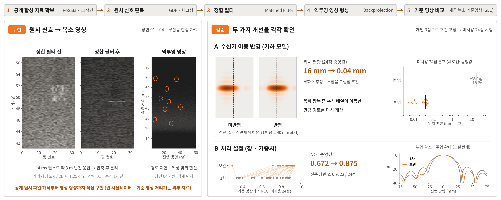
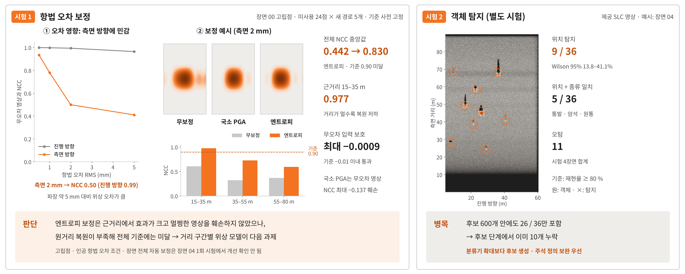

# Side C · SAS — 공개 합성 SAS 원시 신호 처리 · 영상 형성 검증

> **SAS 영상 형성 벤치마크:** 수신기 이동 반영 후 위치 편향 16 → 0.04 mm · 처리 설정 개선 후 기준 영상 NCC 0.67 → 0.88 (합성 자료)

공개 합성개구 소나(Synthetic Aperture Sonar, SAS) 자료(PoSSM)의 **원시 신호(raw IQ)부터 정합필터, 역투영 영상 형성, 항법 오차 보정(autofocus), 객체 위치 탐지까지**를 직접 구현하고, 각 단계의 효과와 한계를 사전에 고정한 기준으로 검증한 개인 연구입니다.

| | |
|---|---|
| **상태** | 분석 완료 · 실행 스크립트로 자료 취득부터 보고서까지 재현 가능 |
| **데이터** | PoSSM simulated SAS data package (MGDS, CC BY-NC-SA 3.0 US) — 무잡음 수중 음향 시뮬레이션 11장면 |
| **평가** | 개발용 점 · 장면에서 조건 고정 → 시험용 점 · 장면 1회 평가 (`results/v3/protocol.json`) |
| **검증 등급** | 합성 자료 내 정량 평가 (실해역 실측 SAS · 실제 기뢰 미검증) |

> **범위 주의**: PoSSM은 무잡음 **수중 음향 시뮬레이션** 자료입니다. 실해역 실측 SAS가 아니며, 객체는 통발 · 암석 · 원통으로 **실제 기뢰가 아닙니다**. 아래 수치는 이 합성 조건에서의 결과입니다.

## 핵심 결과

| 결과 | 수치 | 판정 |
|---|---|---|
| 수신기 이동 반영(음파 왕복 중 이동) | 고립 산란체 위치 편향 중앙값 **16 mm → 0.04 mm** (미사용 24점) | 효과 확인 |
| 처리 설정(창 · 가중치) | 기준 영상(SLC)과의 NCC 중앙값 **0.672 → 0.875** (미사용 24점) | 효과 확인 · 부엽 감소 대신 주엽 확대 |
| 항법 오차 보정(엔트로피 기반) | 측면 2 mm RMS 오차 시 NCC **0.442 → 0.830** | 기준(0.90) 미달 → 미채택 |
| 객체 위치 탐지 | 시험 4장면 36개 중 9개 (재현율 0.25, 장면당 오경보 2.75) | 기준 미달 → 미채택 |

기준을 통과하지 못한 보정기와 탐지기도 결과를 그대로 남겼습니다. 위치 편향의 부화소 수치는 이상적인 고립점 조건의 값으로, 실해역 정확도로 해석하지 않습니다.




## 처리 흐름

| 단계 | 내용 | 구현 |
|---|---|---|
| 1. 자료 확보 | PoSSM 공개 합성 자료 11장면, 다운로드 파일 SHA-256 대조 | `src/download_possm.py`, `src/acquire_all_scenes.py` |
| 2. 원시 신호 판독 | GDF 형식 해석, 체크섬 확인 | `src/gdf.py` |
| 3. 정합 필터 (Matched Filter) | 송신 LFM 펄스 기준 펄스 압축 | `src/imaging.py` |
| 4. 역투영 영상 형성 (Backprojection) | 송수신 분리(bistatic) 경로 지연·위상 보정 합산, 음파 왕복 중 수신기 이동 반영 | `src/imaging.py`, `src/imaging_v2.py` |
| 5. 기준 영상 비교 | 자료에 포함된 복소 기준 영상(SLC)과 복소 정규화 상관(NCC) 비교 | `src/validate_slc_v2.py` |
| 6. 항법 오차 보정 | 국소 위상 기울기 보정(local GPGA), 핑별 엔트로피 최소화 | `src/autofocus_v3.py`, `src/evaluate_autofocus_v3.py` |
| 7. 객체 위치 탐지 | 전체 영상 후보 생성 + 소규모 Random Forest, FROC 평가 | `src/point_detection_v3.py` |

## 상세 결과 (합성 조건)

| 항목 | 결과 |
|---|---|
| 항법 오차 민감도 | 측면(sway) 2 mm RMS 오차에서 무오차 대비 NCC 평균 0.50 → 보정 필요성 확인 |
| 항법 오차 보정, 거리 구간별 | NCC 0.977 / 0.726 / 0.594 |

- 조건은 개발용 점 · 장면에서 먼저 고정하고, 시험용 점 · 장면은 그 뒤에 한 번만 평가했습니다 (`results/v3/protocol.json`).
- 단계별 실험 규약과 한계는 [`docs/README_v1.md`](docs/README_v1.md), [`docs/README_v2.md`](docs/README_v2.md), [`docs/README_v3.md`](docs/README_v3.md)와 오프라인 보고서 [`report_v3/report.html`](report_v3/report.html)에 정리했습니다.

## 구성

```
src/            처리·평가 코드 (v1 영상 형성, v2 검증·민감도, v3 보정·탐지)
results/        실행 결과 (JSON·NPZ, 학습된 소규모 모델 포함, 원시 자료 제외)
  possm/ learning/ transfer/   v1 결과
  v2/                          기준 영상 비교·민감도
  v3/                          보정·탐지 (protocol.json 고정 조건 포함)
report_v1/ report_v2/ report_v3/   단계별 오프라인 HTML 보고서
references/     자료 설명서, 객체·산란체 위치, 다운로드 매니페스트
docs/           단계별 상세 README (실험 규약·한계), 개요 그림
```

## 실행

Python 3.12, CPU, RAM 약 10 GB, 여유 디스크 8 GB 이상에서 실행했습니다. 원시 자료는 저장소에 포함하지 않으며 실행 시 MGDS에서 내려받습니다.

```bash
python -m venv .venv
source .venv/bin/activate
python -m pip install -r requirements_v3.txt
python src/run_v3.py --download      # 자료 취득부터 보정·탐지·검증까지
python src/run_v3.py --report-only   # 보고서만 다시 생성
```

v1(영상 형성·학습 보정)과 v2(기준 영상 검증) 단계의 실행 방법과 세부 규약은 `docs/README_v1.md`, `docs/README_v2.md`, `docs/README_v3.md`를 참고하십시오.

## 관련 저장소

| | 저장소 | 내용 |
|---|---|---|
| **Side A · PAM** | [marine-mammal-classifier-benchmark](https://github.com/jongchan-joseph-lee/marine-mammal-classifier-benchmark) | 해양포유류 음향 분류 레퍼런스 모델 벤치마크 |
| **Side B · SSS** | [sss-mine-detection-benchmark](https://github.com/jongchan-joseph-lee/sss-mine-detection-benchmark) | 측면주사 소나 기뢰유사물체 탐지 · 분류 벤치마크 |
| **Side C · SAS** | SAS_signal_processing (현재) | 공개 합성 SAS 원시 신호 처리 · 영상 형성 검증 |

## 자료 출처와 라이선스

- 자료: PoSSM simulated SAS data package — Philtron, Johnson & Brown, Marine Geoscience Data System (MGDS). Raw GDF [doi:10.60521/331898](https://doi.org/10.60521/331898), SLC [doi:10.60521/331899](https://doi.org/10.60521/331899). CC BY-NC-SA 3.0 US.
- 원본 프로그램 코드: MIT (`LICENSE`).
- PoSSM에서 파생된 결과·그림·보고서·학습 모델: CC BY-NC-SA 3.0 US.
- 참고 방법론(코드·가중치 미사용): Wahl et al. 1994 (PGA), Evers & Jackson 2019 (GPGA), Gerg & Monga 2021 (deep SAS autofocus). 상세는 `THIRD_PARTY.md`.
