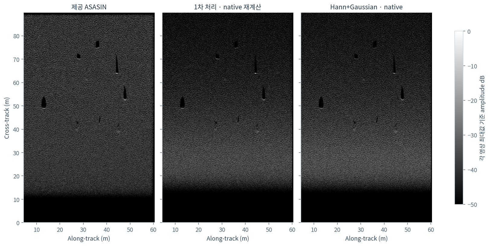
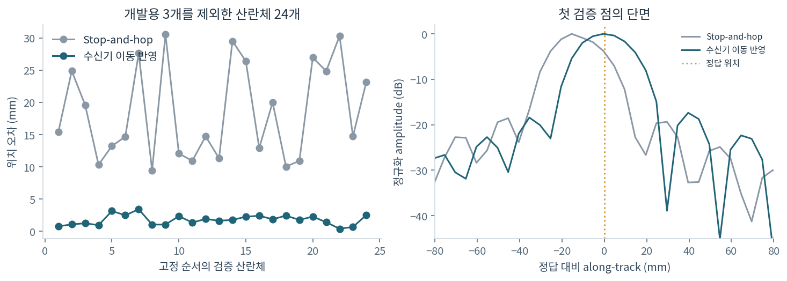
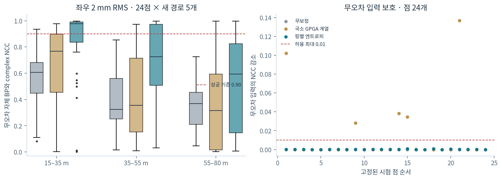
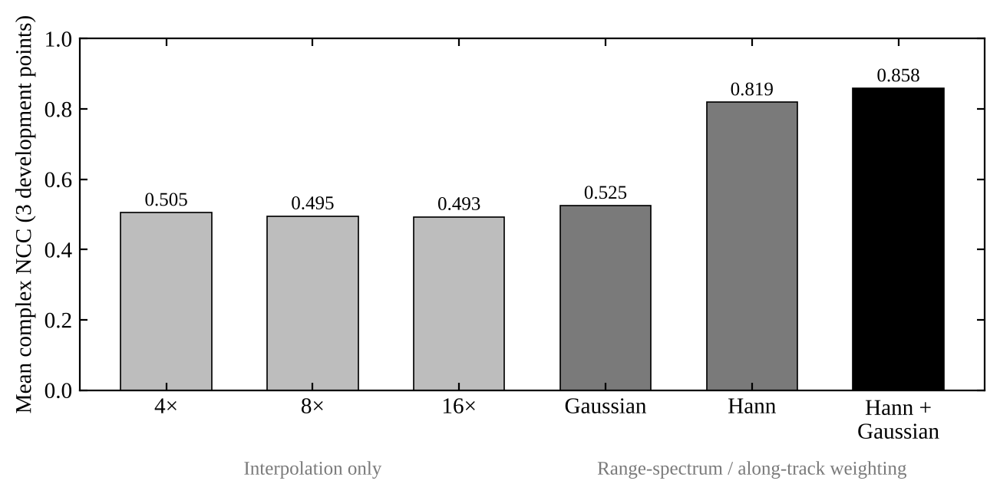
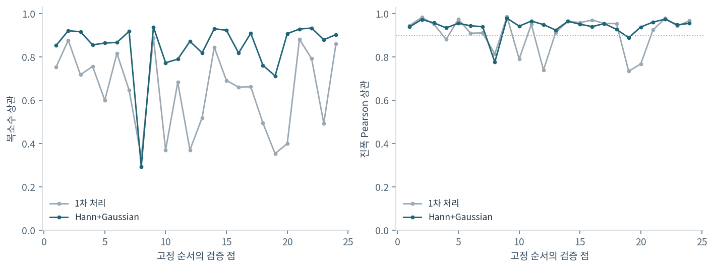
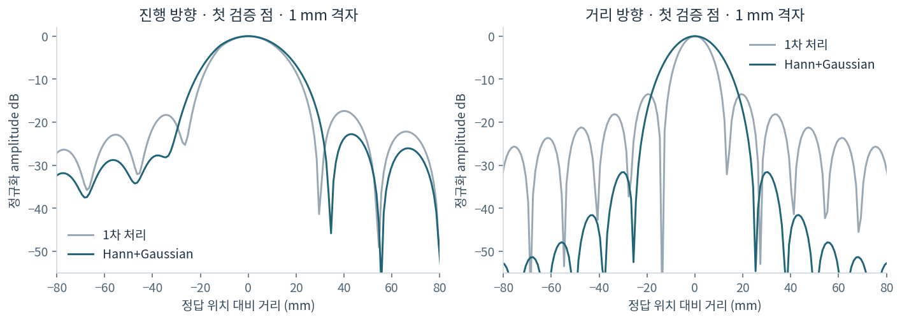
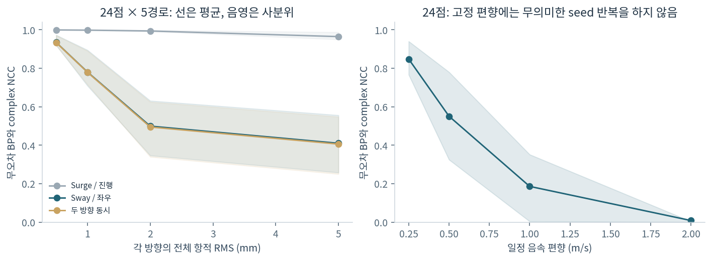
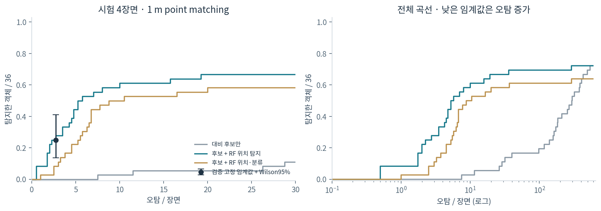
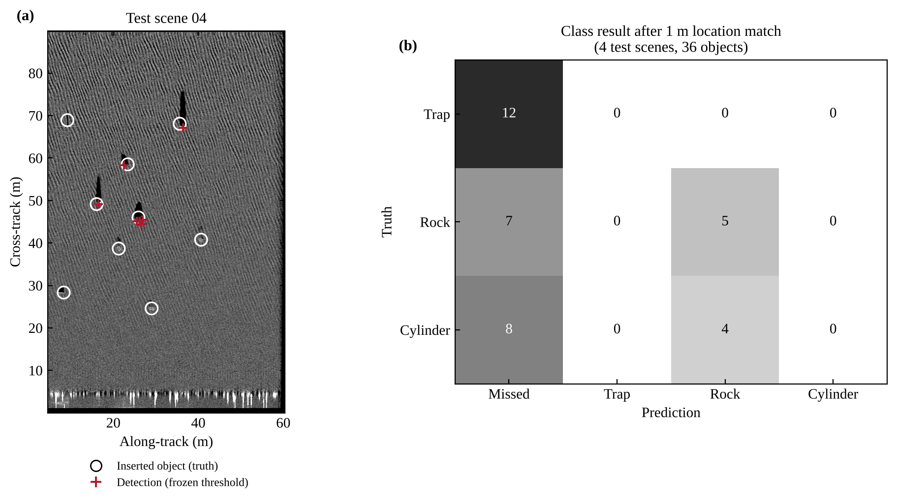

# 공개 합성 SAS 원시 신호의 영상 형성 · 보정 · 탐지 검증

공개 합성개구 소나(Synthetic Aperture Sonar, SAS) 시뮬레이션 자료(PoSSM)의 **원시 신호(raw IQ)에서 출발해 정합필터 → 역투영 영상 형성 → 항법 오차 보정(autofocus) → 객체 위치 탐지**까지 직접 구현하고, 각 단계의 효과를 자료에 포함된 기준 영상과 비교해 검증한 개인 연구입니다. 보정과 탐지 단계는 개발용 자료에서 조건을 먼저 고정하고 시험용 자료로 한 번 평가했으며, 기준을 통과하지 못한 방법도 결과를 그대로 남겼습니다.

| | |
|---|---|
| **자료** | PoSSM simulated SAS data package (MGDS, CC BY-NC-SA 3.0 US) — 무잡음 수중 음향 시뮬레이션 11장면, 원시 GDF와 복소 기준 영상(SLC) |
| **평가** | 기준 영상과의 복소 정규화 상관(complex NCC), 점 확산 함수(PSF), 점 단위 FROC. 보정 · 탐지는 개발/시험 분리 후 고정 조건으로 1회 평가 ([`results/v3/protocol.json`](results/v3/protocol.json)) |
| **실행 환경** | Python 3.12, CPU, RAM 약 10 GB, 여유 디스크 8 GB 이상 |
| **검증 범위** | 합성 자료 내부 정량 평가까지. 잡음 · 실측 SAS · 실제 기뢰 · 실시간 처리는 다루지 않음 |

> PoSSM은 실해역 실측 자료가 아닌 **무잡음 시뮬레이션**이며, 장면 속 객체는 통발 · 암석 · 원통으로 **실제 기뢰가 아닙니다**. 아래 수치는 모두 이 합성 조건에서의 결과입니다.

## 1. 배경

SAS는 플랫폼이 이동하며 받은 여러 핑(ping)을 위상까지 맞춰 합성해 고해상도 영상을 만듭니다. 그래서 영상 품질은 신호처리 체인의 세부 가정, 즉 송수신 경로 지연, 음파가 왕복하는 동안의 수신기 이동, 항법 위치 오차에 크게 좌우됩니다. 공개된 SAS 자료는 대부분 처리된 영상만 제공하지만, PoSSM은 **원시 신호와 그 신호로 만든 기준 영상(ASASIN SLC)**, 그리고 산란체 · 객체의 정답 위치를 함께 제공합니다. 따라서 직접 구현한 처리 결과를 기준 영상과 정량 비교할 수 있습니다.

**연구 질문**
1. 원시 신호에서 직접 만든 영상은 제공된 기준 영상과 어느 정도 일치하며, 어떤 처리 가정이 차이를 만드는가?
2. 항법 오차가 영상 품질을 얼마나 떨어뜨리고, 보정 기법은 그 손실을 어디까지 회복하는가?
3. 전체 영상에서 정답 위치 정보 없이 객체 위치를 찾을 때 재현율과 오경보는 어느 수준인가?

## 2. 방법론

### 단계별 수행 범위

수행 범위는 다음처럼 구분했습니다. **구현 확인**은 동작과 지표 계산까지, **사전 고정 시험**은 개발용 자료로 조건과 성공 기준을 먼저 정한 뒤 시험용 자료로 1회 평가한 것입니다.

| 단계 | 내용 | 수행 범위 | 근거 |
|---|---|---|---|
| 1. 자료 확보 | PoSSM 11장면 내려받기, SHA-256 대조, GDF 형식 해석 | 수행 (구현 확인) | [`src/download_possm.py`](src/download_possm.py), [`src/acquire_all_scenes.py`](src/acquire_all_scenes.py), [`src/gdf.py`](src/gdf.py) |
| 2. 정합필터 | 송신 펄스 복제 신호 상관으로 펄스 압축 | 수행 (구현 확인) | [`src/imaging.py`](src/imaging.py) |
| 3. 역투영 영상 형성 | 송수신 분리(bistatic) 경로 지연 · 위상 보정 합산, 음파 왕복 중 수신기 이동 반영 | 수행 — 조건은 개발용 산란체 3개로 정하고 나머지 24개로 평가 | [`src/imaging.py`](src/imaging.py), [`src/imaging_v2.py`](src/imaging_v2.py) |
| 4. 기준 영상 비교 · 처리 설정 | 기준 SLC와 complex NCC, PSF 비교. 보간 배율 · 거리 주파수 창(Hann) · 방위 Gaussian 가중 비교 | 수행 — 설정은 개발용 3점으로 정하고 시험 24점에서 다시 고르지 않음 | [`src/validate_slc_v2.py`](src/validate_slc_v2.py), [`src/diagnose_taper.py`](src/diagnose_taper.py) |
| 5. 항법 오차 민감도 | 원시 IQ는 고정하고 처리에 쓰는 가정 항적 · 음속만 바꿔 영상 품질 변화 측정 | 수행 (24점 × 5경로) | [`src/stress_points_v2.py`](src/stress_points_v2.py) |
| 6. 항법 오차 보정 | 국소 위상 기울기 보정(local GPGA)과 핑별 엔트로피 최소화 비교 | 사전 고정 시험 — 성공 기준 미달 | [`src/autofocus_v3.py`](src/autofocus_v3.py), [`src/evaluate_autofocus_v3.py`](src/evaluate_autofocus_v3.py) |
| 7. 객체 위치 탐지 | 전체 영상 후보 생성 + Random Forest, 점 단위 FROC | 사전 고정 시험 — 성공 기준 미달 | [`src/point_detection_v3.py`](src/point_detection_v3.py) |
| 8. 원시 신호 → 탐지 연결 | 직접 만든 역투영 영상에 고정된 탐지기를 그대로 적용 | 탐색적 (1장면, 9개 객체) | [`src/raw_detection_bridge_v3.py`](src/raw_detection_bridge_v3.py) |
| 9. 잡음 · 실측 자료 · 실시간 | 잡음 포함 자료, 실해역 SAS, 탑재 처리 | 미수행 | — |

### 평가 규약에서 정한 것
- **사전 고정 조건**: 보정 · 탐지 단계의 개발/시험 점 · 장면, 하이퍼파라미터 후보, 성공 기준을 시험 결과를 보기 전에 [`results/v3/protocol.json`](results/v3/protocol.json)에 기록했습니다. 외부 기관에 등록한 사전등록(preregistration)은 아닙니다.
- **항법 오차 보정 성공 기준**: 시험 24점 × 5경로에서 기준 대비 complex NCC 중앙값 0.90 이상, 그리고 오차가 없는 입력에서 NCC 감소 0.01 이하.
- **탐지 성공 기준**: 검증 장면에서 고정한 임계값으로 시험 4장면 재현율 0.8 이상, 장면당 오경보 5개 이하. 일치 반경 1 m, 중복 검출은 오경보로 셉니다. 표본이 작아 탐색적 기준으로 명시했습니다.
- **정답 정보 사용 범위**: 보정 평가는 정답으로 고른 고립 산란체 주변 영역 안에서 수행했습니다. 보정기 자체는 정답 위상이나 위치를 쓰지 않습니다. 탐지는 정답 영역 제한 없이 전체 유효 영상에서 후보를 생성했습니다.

## 3. 실행 예시

```bash
python -m venv .venv
source .venv/bin/activate
python -m pip install -r requirements_v3.txt

# 전체 재현: 자료 취득부터 보정 · 탐지 · 검증 · 보고서까지
python src/run_v3.py --download
python src/run_v3.py --report-only       # 결과 JSON으로 보고서만 다시 생성

# 단계별 실행 (v3)
python src/protocol_v3.py                           # 고정 조건 기록 → results/v3/protocol.json
python src/evaluate_autofocus_v3.py --stage develop # 6. 개발용 점으로 보정 설정 선택
python src/point_detection_v3.py --stage train      # 7. 학습 · 검증 장면으로 탐지기 학습, 임계값 고정
python src/evaluate_autofocus_v3.py --stage test    # 6. 시험 24점 × 5경로 1회 평가
python src/point_detection_v3.py --stage test       # 7. 시험 4장면 1회 평가
python src/raw_detection_bridge_v3.py               # 8. 직접 만든 역투영 영상에 고정 탐지기 적용
python src/verify_v3.py                             # 결과 파일 · 해시 점검
```

- 원시 자료(압축 해제 기준 약 2.4 GB)는 저장소에 포함하지 않으며 실행 시 MGDS에서 내려받습니다.
- 결과 JSON · NPZ와 학습된 소규모 탐지기는 [`results/`](results/)에 있어 원자료 없이도 수치를 확인할 수 있습니다. 단계별 오프라인 보고서는 [`report_v1/`](report_v1/), [`report_v2/`](report_v2/), [`report_v3/report.html`](report_v3/report.html)입니다.
- 영상 형성(v1)과 기준 영상 검증(v2)의 단계별 실행 명령과 세부 규약은 [`docs/README_v1.md`](docs/README_v1.md), [`docs/README_v2.md`](docs/README_v2.md), [`docs/README_v3.md`](docs/README_v3.md)에 정리했습니다.

## 4. 주요 결과

| 항목 | 결과 | 조건 |
|---|---|---|
| 수신기 이동 반영 | 고립 산란체 위치 오차 중앙값 **15.1 → 1.8 mm** (격자 정점) | 조건 결정에 쓰지 않은 24점, 5 mm 고정 격자 |
| 〃 (부화소 추정) | **16.4 → 0.04 mm** | 같은 24점 · 5 mm 격자, 정점 주변 2차 곡면 보간. 이상적 무잡음 고립점 조건 |
| 처리 설정(Hann + Gaussian) | 기준 SLC와 complex NCC 중앙값 **0.672 → 0.875**, 진폭 상관 0.9 이상 18 → 22점 | 시험 24점, native 격자. 최저점 0.292 |
| 항법 오차 민감도 | 좌우(sway) 2 mm RMS에서 무오차 영상 대비 NCC 평균 **0.50**, 진행(surge) 2 mm에서 0.99 | 24점 × 5경로 |
| 항법 오차 보정 | NCC 중앙값 보정 전 0.442 → local GPGA 0.533 → 핑별 엔트로피 **0.830** | 시험 24점 × 5경로, 좌우 2 mm RMS. 기준 0.90 미달 → **미채택** |
| 객체 위치 탐지 | 시험 36개 중 **9개** 탐지(재현율 0.25, 95% 구간 0.14–0.41), 장면당 오경보 2.75 | 시험 4장면, 일치 반경 1 m. 기준 0.8 미달 → **미채택** |

근거: [`results/v2/`](results/v2/) (기준 영상 비교 · 위치 · 민감도: `stress_results.json`), [`results/v3/autofocus_results.json`](results/v3/autofocus_results.json), [`results/v3/detection_results.json`](results/v3/detection_results.json). 위치 오차 수치는 [`report_v2/report.html`](report_v2/report.html)의 PSF · 부화소 위치 표와 같습니다.

<p align="center"></p>
<p align="center"><sub>제공 기준 영상(ASASIN SLC)과 직접 구현한 역투영 영상. 1차 처리와 Hann + Gaussian 설정 적용 결과 (scene00, native 격자)</sub></p>

<p align="center"></p>
<p align="center"><sub>정지 가정(stop-and-hop)과 수신기 이동 반영 모델의 위치 오차. 조건 결정에 쓰지 않은 산란체 24개, 5 mm 격자</sub></p>

<p align="center"></p>
<p align="center"><sub>항법 오차 보정의 거리 구간별 결과(왼쪽)와 오차가 없는 입력에서의 NCC 손실(오른쪽). 점선은 사전 고정 기준</sub></p>

<details>
<summary><b>그림 더 보기</b> — 처리 설정 · PSF · 민감도 · 탐지</summary>

<p align="center"></p>
<p align="center"><sub>개발용 3점에서 보간 배율과 창 설정 비교 (이 결과로 설정을 정함)</sub></p>

<p align="center"></p>
<p align="center"><sub>시험 24점의 복소수 상관(왼쪽)과 진폭 상관(오른쪽), 1차 처리 vs Hann + Gaussian</sub></p>

<p align="center"></p>
<p align="center"><sub>첫 검증 점의 PSF (1 mm 격자). 창 적용으로 부엽은 낮아지고 주엽은 넓어짐</sub></p>

<p align="center"></p>
<p align="center"><sub>항적 오차(진행 · 좌우 · 동시)와 음속 편향에 따른 영상 일치도. 24점 × 5경로, 음영은 사분위</sub></p>

<p align="center"></p>
<p align="center"><sub>시험 4장면 점 단위 FROC. 검은 점은 검증 장면에서 고정한 운영점과 Wilson 95% 구간</sub></p>

<p align="center"></p>
<p align="center"><sub>시험 장면 탐지 예시(왼쪽)와 1 m 위치 일치 이후 클래스 결과(오른쪽)</sub></p>

</details>

## 5. 고찰

**수신기 이동 반영은 위치 편향을 제거한 것이지 분해능을 높인 것이 아닙니다.** 음파가 왕복하는 동안 수신기가 움직인 거리를 반영하지 않으면 산란체 위치가 약 16 mm 일정하게 밀렸고, 반영 후 이 편향이 사라졌습니다. 부화소 0.04 mm는 잡음이 없는 이상적 고립점에서 얻은 값이므로 실해역 위치 정확도로 해석하지 않습니다.

**기준 영상과의 일치도가 높아진 것이 영상 품질 향상을 뜻하지는 않습니다.** 보간 배율만 높여서는 일치도가 거의 변하지 않았고(0.505 → 0.493), 거리 주파수 창을 적용하자 0.858로 올랐습니다. 이는 기준 영상이 비슷한 창 처리를 거쳤을 가능성을 시사합니다. 창 적용은 부엽을 낮추는 대신 주엽을 넓힙니다(시험 24점 중앙값 기준 진행 방향 3 dB 폭 24.4 → 26.8 mm, 거리 방향 12.0 → 18.3 mm). 장면 전체 일치도에는 여전히 차이가 남아 있으며, 거리별 진폭 처리 차이가 한 요인으로 관찰되었지만 원인을 확정하지 못했습니다.

**좌우 방향 항법 오차가 진행 방향보다 훨씬 민감했습니다.** 같은 2 mm RMS에서 진행 방향 오차는 NCC 0.99를 유지했지만 좌우 방향은 0.50으로 떨어졌습니다. 고주파 SAS에서 mm 단위 좌우 위치 정확도가 영상 형성에 필요하다는 점을 보여 주는 결과이며, 보정 단계를 시험한 이유입니다.

**핑별 엔트로피 보정은 부분 회복에 그쳤고, 거리가 멀수록 효과가 줄었습니다.** 중앙값은 0.442 → 0.830으로 올랐지만 기준 0.90에는 미달했습니다. 거리 구간별로는 0.977 (15–35 m) / 0.726 (35–55 m) / 0.594 (55–80 m)였습니다. 엔트로피 보정은 오차가 없는 입력을 거의 손상시키지 않았고(최대 손실 0.0009), local GPGA는 최대 0.137까지 손상시켰습니다. 먼 거리에서 오차 구조가 달라지는지는 확인하지 못했습니다.

**전체 영상 탐지는 후보 생성 단계가 상한을 정했습니다.** 오경보를 장면당 593.5개까지 허용해도 후보가 36개 중 26개만 포함했습니다. 고정 운영점에서는 9개를 찾았고, 클래스까지 맞춘 경우는 5개였습니다. 직접 만든 역투영 영상에 같은 탐지기를 적용한 탐색 시험(1장면)에서는 9개 중 3개를 찾았습니다. 표본이 작아 기준 영상과 직접 만든 영상 사이의 탐지 성능 차이는 판단하지 않습니다.

**남은 질문**
- 기준 영상과의 장면 전체 차이는 어떤 처리 단계(거리별 진폭 규약, 보간, 창)에서 생기는가?
- 먼 거리 구간에서 엔트로피 보정의 효과가 줄어드는 원인은 무엇인가?
- 잡음과 실제 해저 반향이 있는 자료에서도 같은 처리 순서와 판단이 유지되는가?

## 6. 한계

- 무잡음 시뮬레이션 자료 한 종류의 결과입니다. 실측 SAS, 잡음 환경, 실제 기뢰에서의 성능은 검증하지 않았습니다.
- 항법 오차는 원시 신호를 바꾸지 않고 처리에 쓰는 가정 항적만 바꿔 만든 것입니다. 실제 항법 오차의 모든 형태를 대표하지 않습니다.
- 보정 평가는 정답으로 고른 고립 산란체 주변 영역에서 수행했으며, 전체 장면 자동 보정 성능이 아닙니다.
- 탐지 시험은 4장면 36개 객체로 표본이 작고, 신뢰구간이 넓습니다.
- 사전 고정 조건은 이 저장소 안의 기록이며 외부 사전등록이 아닙니다.
- v1에서 시험한 소규모 CNN 위상 보정기(평균 NCC 0.755–0.762, 손상 영상 0.760)는 손상 영상 대비 개선이 없어 채택하지 않았습니다. 상세는 [`docs/README_v1.md`](docs/README_v1.md)에 있습니다.

## 데이터와 인용

- PoSSM simulated SAS data package — Philtron, Johnson & Brown, Marine Geoscience Data System (MGDS). Raw GDF [doi:10.60521/331898](https://doi.org/10.60521/331898), SLC [doi:10.60521/331899](https://doi.org/10.60521/331899). CC BY-NC-SA 3.0 US.
- 참고 방법론(코드 · 가중치 미사용): Wahl et al. 1994 (PGA), Evers & Jackson 2019 (GPGA), Gerg & Monga 2021 (deep SAS autofocus). 상세는 [`THIRD_PARTY.md`](THIRD_PARTY.md).

## 관련 저장소

- [marine-mammal-classifier-benchmark](https://github.com/jongchan-joseph-lee/marine-mammal-classifier-benchmark) — Watkins 해양포유류 음향 DB의 레퍼런스 표현 평가 (원고 초안)
- [sss-mine-detection-benchmark](https://github.com/jongchan-joseph-lee/sss-mine-detection-benchmark) — 측면주사 소나 공개 영상의 기뢰유사물체 탐지 · 분류 평가

## 라이선스

원본 프로그램 코드는 MIT License를 따릅니다 ([`LICENSE`](LICENSE)). PoSSM에서 파생된 결과 · 그림 · 보고서 · 학습 모델은 CC BY-NC-SA 3.0 US를 따릅니다.
